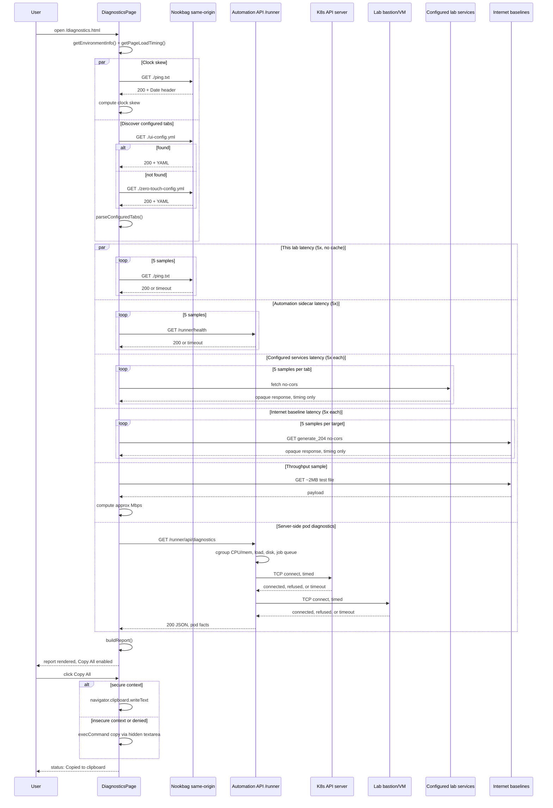

## Diagnostics page (/diagnostics.html)

This document describes the standalone network/cluster diagnostics page: what it is, what it checks, and how to read its output.

- Source of truth:
  - `nookbag/src/public/diagnostics.html` (page shell)
  - `nookbag/src/public/diagnostics.js` (all logic)
  - `nookbag/src/public/ping.txt` (same-origin latency probe target)
  - Companion server-side endpoint: `GET /api/diagnostics` in [zerotouch-automation](https://github.com/rhpds/zerotouch-automation), reachable here at `/runner/api/diagnostics`

## What it is

A support tool for the "the lab feels slow" case. When a user messages in Slack about a slow lab, point them at `/diagnostics.html`. It runs a battery of checks from their own browser plus a call to the automation sidecar, assembles one plain-text report, and gives them a **Copy All** button to paste into Slack.

It is a plain HTML/JS page in `src/public/`, copied verbatim into `dist/` by Vite (the same pattern as `placeholder.html`) — it is **not** part of the React app and has no dependency on `ui-config.yml` parsing succeeding or the automation API being reachable. This is deliberate: the page a user is told to load to debug a broken lab should keep working even when the rest of the lab is broken.

## What it does

The page auto-runs once on load (and can be re-run via the "Run Diagnostics" button). It performs:

1. **Browser/connection environment info** — user agent, platform, screen/viewport, timezone, `navigator.onLine`, and the Network Information API (`navigator.connection`) when the browser supports it (Chromium-only; Firefox/Safari never expose it).
2. **This page's own load timing** — via the Navigation Timing API (DNS, TCP, TLS, TTFB, download, total).
3. **Clock skew** — compares the `Date` response header from a same-origin fetch to the browser's local clock.
4. **Repeated latency samples** (5x each, `cache: 'no-store'` so the browser cache can't fake a fast repeat, every fetch bounded by a timeout) against four categories, so a Slack reader can immediately see *where* the slowness is:
   - **This lab** — same-origin `./ping.txt`, via cluster ingress.
   - **Automation sidecar** — `/runner/health`.
   - **Configured services** — every unique origin found in the already-loaded `ui-config.yml` / `zero-touch-config.yml` `tabs[]` (reusing the same URL-construction rules as `app.tsx`), labeled by tab name. This is what catches "the OpenShift console took a minute to load" — the console (or any other embedded service) is just another configured tab.
   - **Internet baseline** — fixed, purpose-built connectivity-check endpoints (Cloudflare, Google, Red Hat) via `no-cors` GETs. If these are slow too but the lab's own targets are fast, the problem is the user's network, not ours.
5. **A rough throughput sample** — one ~2MB download, to approximate Mbps and distinguish "hotel wifi" from "fiber." Single-stream, approximate — labeled as such in the report.
6. **Server-side pod diagnostics** — one call to `/runner/api/diagnostics`, timed. Its own round-trip time is itself a useful "automation API latency" data point, and a timeout/failure here is reported as-is rather than swallowed. See the [zerotouch-automation README](https://github.com/rhpds/zerotouch-automation#api-endpoints) for the full response shape (cgroup CPU/memory pressure, load average, disk, job-queue backlog, and raw TCP-connect timing to the in-cluster API server and the lab's bastion/VM).

All of the above assembles into one plain-text report (wrapped in a Slack code fence) rendered in a `<pre>` block. **Copy All** uses the Clipboard API first, falling back to a hidden-textarea `execCommand('copy')` — the fallback matters because `navigator.clipboard` is undefined in any non-secure (plain HTTP) context, not just old browsers, and some showroom deployments may be reached over HTTP.

Every network call in the page is wrapped in a shared `fetchWithTimeout()` helper. A diagnostics tool that can itself hang forever on a slow/wedged request would defeat its own purpose — exactly the "cluster is slow" scenario it exists to diagnose — so nothing in this page can block indefinitely.

## Known limitation

This page (plus the pod-level checks in `/api/diagnostics`) cannot see cluster-wide health: other tenants' noisy-neighbor load, node pressure, or etcd/apiserver internals. If everything it reports looks clean but the user still reports slowness, the documented next step — shown on the page itself — is checking cluster monitoring (`oc adm top nodes`, Prometheus/Grafana) from an ops console.

## Request flow

## Security note

This page and `/api/diagnostics` are unauthenticated, matching the rest of `/runner/*` in this stack. A security review of both covered the "someone guesses the lab's random URL" threat model: no credential/token/kubeconfig leakage, no XSS (the report is written via `textContent`, never `innerHTML`), and no arbitrary SSRF/port-scanning (the server-side TCP checks only ever target two env-fixed hosts, never a caller-controlled one). The one accepted finding: the K8s API server and bastion/VM `host`/`port` are returned as plain fields in the `/api/diagnostics` response, which is new infrastructure recon a browser couldn't otherwise obtain. Given these are short-lived, randomly-URLed lab environments, this was reviewed and accepted as-is (tracked in GPTEINFRA-18277).
